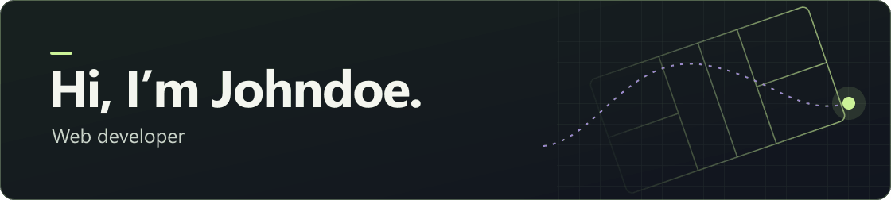
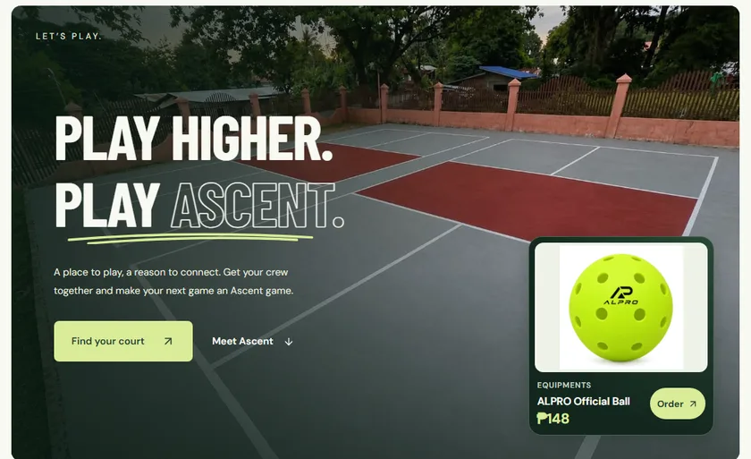

<h1 align="center">
  
</h1>

I build web and desktop applications.

  <a href="mailto:johndoedelacruz29@gmail.com">Email</a>
  · <a href="https://www.linkedin.com/in/johndoe-amiel-dela-cruz-b33b95359/">LinkedIn</a>
  · <a href="https://www.facebook.com/JohndoeDC/">Facebook</a>

## Featured projects

<table>
  <tr>
    <td width="50%" valign="top">
      
      <h3>Ascent Pickleball</h3>
      
Court booking and open play, with staff tools for GCash payment review, point of sale, and player queues.

      
<a href="https://ascentpickleball.vercel.app/">Live site ↗</a> · <a href="https://github.com/JohndoeDelaCruz/AscentPickleball">Repository ↗</a>

    </td>
    <td width="50%" valign="top">
      
      <h3>Qubix</h3>
      
Offline classroom quizzes for Windows. Students join on phones over local Wi-Fi or play team games on a shared screen.

      
<a href="https://github.com/JohndoeDelaCruz/Qubix">Repository ↗</a>

    </td>
  </tr>
</table>

## Tech stack

**Web** ·       
**Backend and data** ·        
**Desktop and machine learning** ·   

## GitHub trophies

  <picture>
    <source media="(prefers-color-scheme: dark)" srcset="https://github-trophy-jagratadeb.vercel.app/?username=JohndoeDelaCruz&amp;title=Repositories%2CCommits%2CExperience&amp;column=3&amp;margin-w=10&amp;theme=darkhub" />
    
  </picture>

